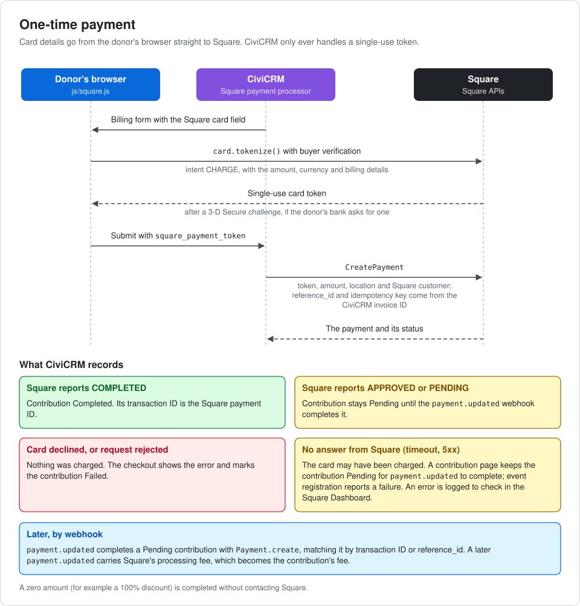
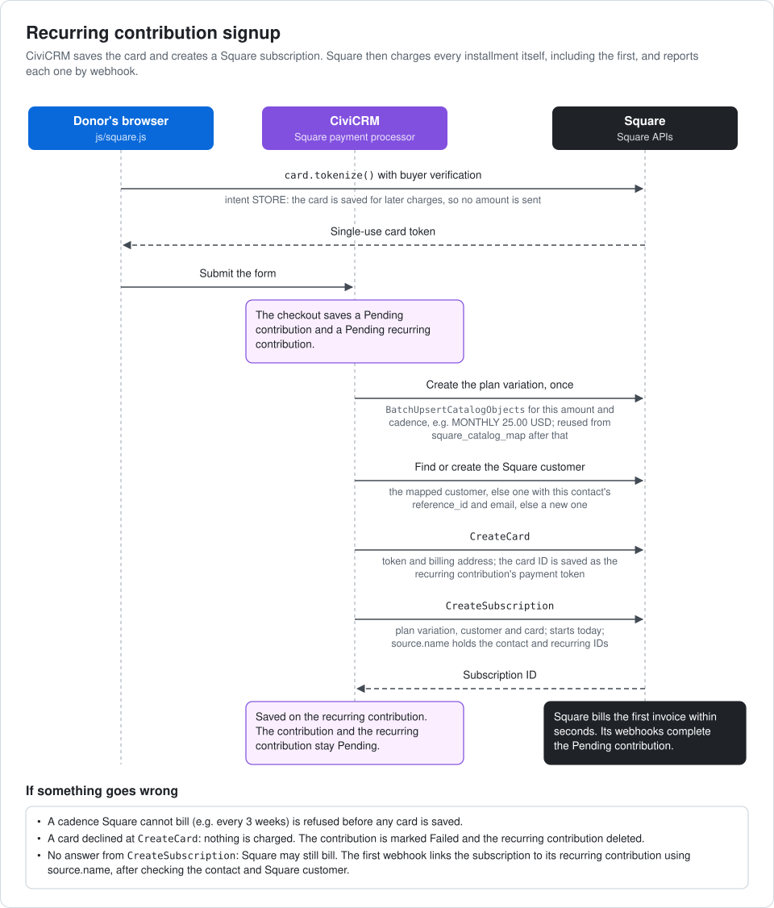
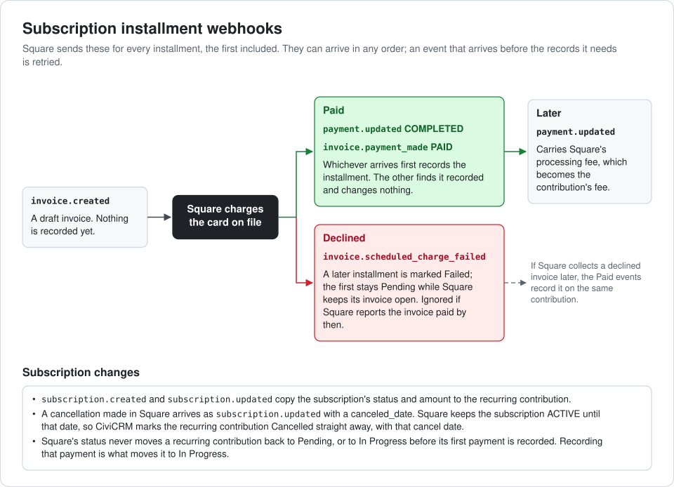
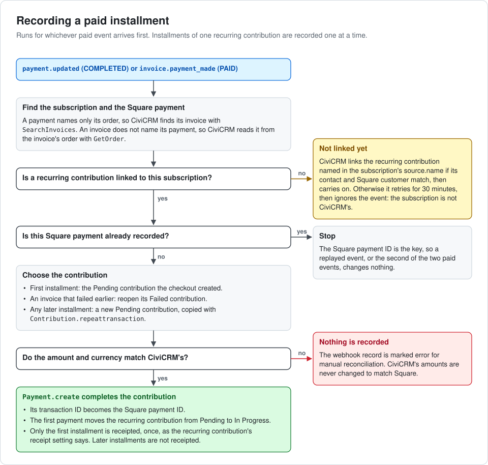
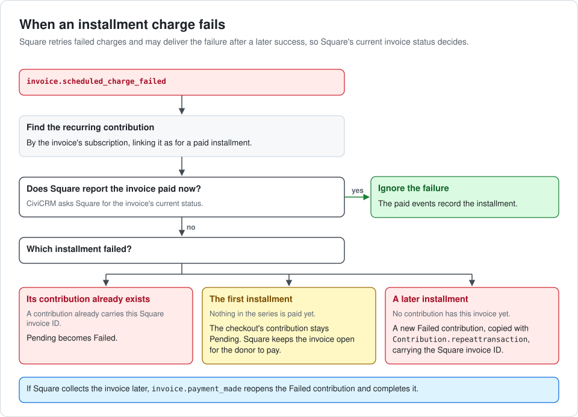
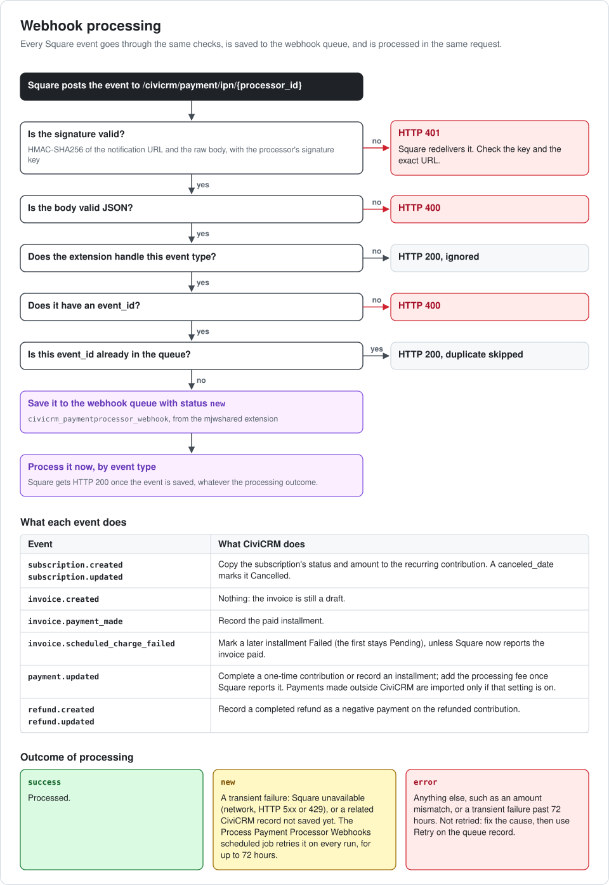

# Workflows

Diagrams of how a payment moves between the donor's browser, CiviCRM and
Square, and what CiviCRM does with each Square webhook. [Architecture](ARCHITECTURE.md)
and [Webhooks](WEBHOOKS.md) have the details behind them.

## One-time payment

The browser tokenizes the card with Square, and CiviCRM charges that token with
`CreatePayment`. What CiviCRM records depends on Square's answer.

## Recurring contribution signup

CiviCRM saves the card and creates a Square subscription. Nothing is charged at
checkout: Square charges the first installment itself, within seconds.

## Subscription installment webhooks

The events Square sends for each installment, paid or declined, and how
subscription changes (including cancellations made in Square) reach CiviCRM.

## Recording a paid installment

The first installment completes the checkout's Pending contribution; each
later one becomes a new contribution. The Square payment ID makes recording
safe to repeat.

## When an installment charge fails

Square retries failed charges and can deliver the failure after a later
success, so CiviCRM checks the invoice's current status first.

## Webhook processing

Every event is checked, saved to the webhook queue, and processed in the same
request. Transient failures are retried by the scheduled job for up to 72 hours.

